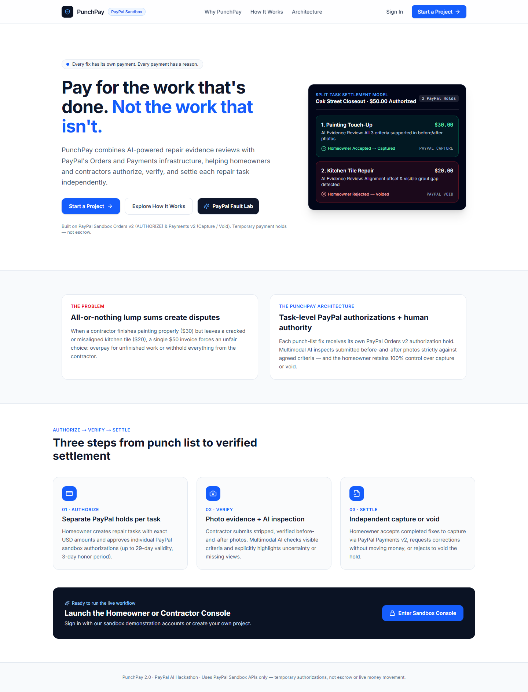
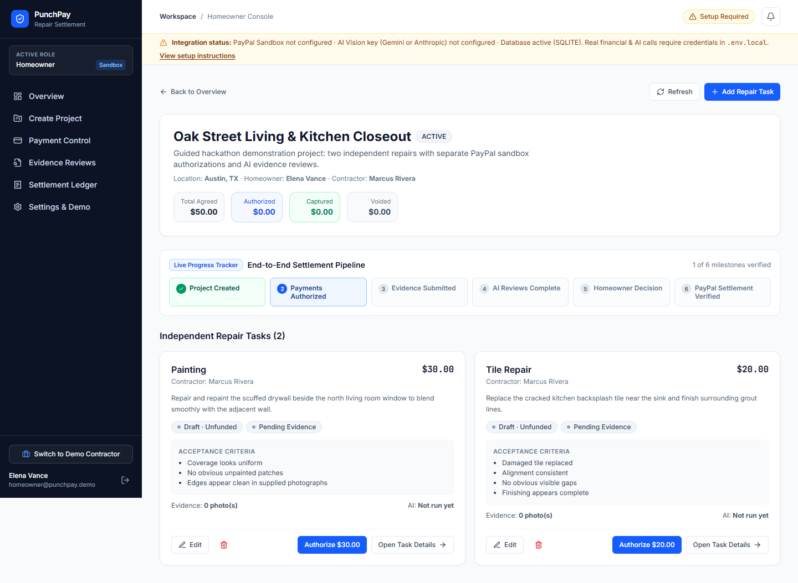
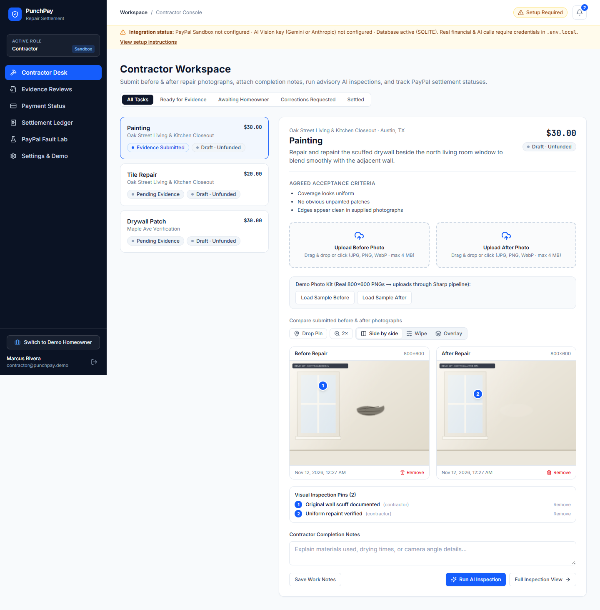
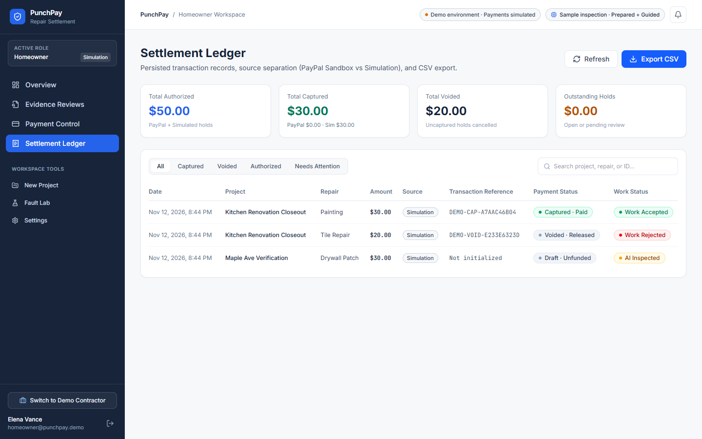
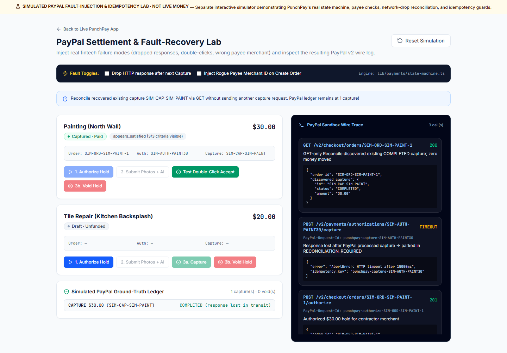
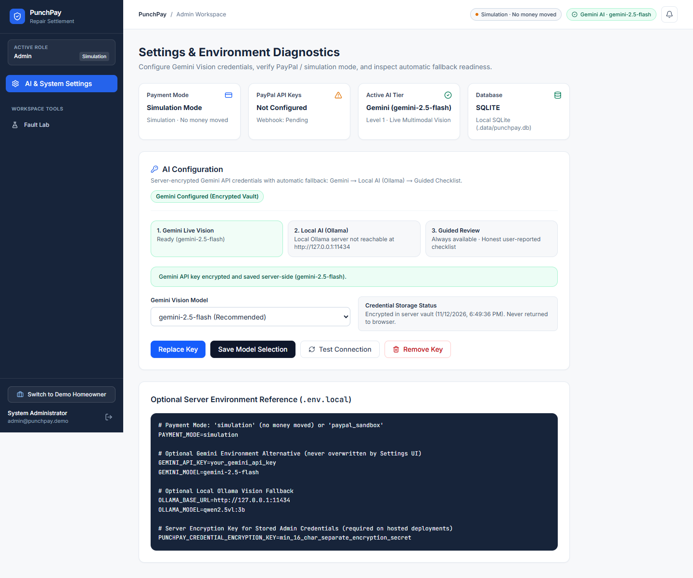
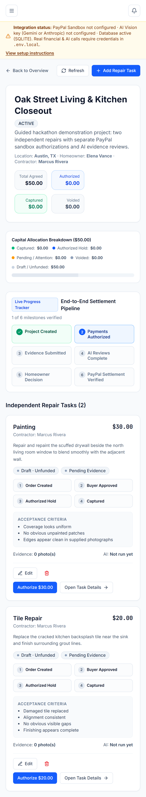

# PunchPay — PayPal AI Hackathon

> **Every fix has its own payment.** *Review the work. Decide what gets paid.*  
> **Author:** [Anmol Singh](https://github.com/Anmol-coder26) · **License:** [MIT](LICENSE)

PunchPay is an AI-assisted repair-evidence verification and **task-level PayPal settlement workspace**. Instead of forcing homeowners and contractors into unfair all-or-nothing lump sums, each repair task receives its own independent authorization hold (for example, **$30.00 Painting** and **$20.00 Tile Repair**). Contractors submit before-and-after photographic evidence, vision analysis or structured checklists summarize visible evidence against agreed criteria, and homeowners decide independently what to **Capture** or **Void**.

> **Transparency & Payment Disclosure:**  
> - PunchPay models **temporary payment authorizations** (not escrow) using PayPal Orders v2 (`intent: "AUTHORIZE"`) & Payments v2 (`Capture` / `Void`).  
> - By default in `.env.example`, PunchPay boots in **Interactive Demo Mode** (`PUNCHPAY_DEMO_MODE=true`, `PAYMENT_MODE=simulation`, `AI_PROVIDER=demo`) so judges and reviewers can run the entire workflow locally with **zero external API keys**. Every simulated action is explicitly labeled **`Demo environment · Payments simulated`** (`DEMO-ORD-*`, `DEMO-AUTH-*`, `DEMO-CAP-*`, `DEMO-VOID-*`), and prepared sample inspections are labeled **`Sample inspection · Prepared findings`**.  
> - Real **PayPal Sandbox** (`PAYMENT_MODE=paypal_sandbox`) and **Gemini Vision / Ollama** integrations remain intact and can be enabled via `.env.local` and the Admin Vault (`/settings`).

---

## Visual Tour (Actual Website Screenshots)

### 1. Landing Overview & Split-Settlement Model


### 2. Project Workspace, Task Timelines & Final Settlement Statement
Two independent repairs settled separately: **$30.00 Painting (`DEMO-CAP-*`)** accepted and captured, **$20.00 Tile Repair (`DEMO-VOID-*`)** rejected and voided — cleanly tracked in SQLite.



### 3. Contractor Desk, Sharp-Verified Photo Kit, Pin Annotations & Comparison Tools
Supports drag-and-drop uploads, `Demo Photo Kit` presets, click-to-drop synchronized callout pins, `Wipe` slider, `Overlay` onion-skin, and `2×` zoom.



### 4. Settlement Ledger & CSV Audit Export
Persistent transaction history separated cleanly by source (`Simulation` vs `PayPal`), searchable and filterable with `DEMO-*` capture and void references.



### 5. PayPal Fault-Recovery Lab, Diagnostics & Mobile Experience

<table>
  <tr>
    <td width="65%" valign="top">
      <strong>PayPal Fault-Recovery & Idempotency Lab (<code>/playground</code>)</strong><br/>
      
      <br/><br/>
      <strong>Settings, Mode Diagnostics & Encrypted Admin Vault (<code>/settings</code>)</strong><br/>
      
    </td>
    <td width="35%" valign="top">
      <strong>Responsive Mobile Project View</strong><br/>
      
    </td>
  </tr>
</table>

---

## Key Features & Architecture

### Financial Lifecycle (Task-Scoped Authorization -> Capture / Void)
```text
[1. Create Order] ──▶ [2. Buyer Approval] ──▶ [3. Authorized Hold] ──┬──▶ Accept & Capture ($30.00) ──▶ CAPTURED
  DEMO-ORD-* /         Realistic Approval       DEMO-AUTH-* /         │
  PayPal Orders v2     Confirmation Modal       PayPal Authorizations │
                                                                      └──▶ Reject & Void ($20.00) ────▶ VOIDED
                                                                           DEMO-VOID-* / PayPal Void
```
- **Homeowner Authority Only:** Contractors can upload evidence and request reviews, while authorization, capture, correction requests, and voiding are strictly gated (`403`) to the homeowner role.
- **Buyer-Approval Confirmation Flow:** Authorizing a task opens an explicit approval modal displaying the repair task, contractor, hold amount, and what an authorization hold means before issuing `DEMO-ORD-*` -> `DEMO-AUTH-*`.
- **Safe `Reset Demo` & Project Editing:** Homeowners can edit projects (`PATCH /api/projects/[id]`) and reset only guided demo data (`POST /api/demo/reset`) without deleting their own custom projects.

### Inspection Architecture (Prepared Demo + 4-Prompt Guided Review + Preserved Live AI)
1. **Prepared Demo Inspection (`AI_PROVIDER=demo`):** Matches 6 curated domain scenarios in `public/demo-kit/` using normalized 160×120 RGB SHA-256 hashes + repair-category validation (`lib/ai/prepared-demo.ts`) with zero live API calls, explicitly badged **Sample inspection · Prepared findings**.
2. **Honest Guided Review Fallback (`POST /api/tasks/[id]/guided-review`):** Uploading any arbitrary non-sample image automatically switches to a 4-prompt human visual inspection checklist (**Guided Review — Visual assessment by homeowner**), refusing to attach fake AI verdicts to uninspected photos.
3. **Preserved Live Gemini Vision & Local Ollama (`lib/ai/provider.ts`):** When enabled outside Demo Mode, supports Gemini multimodal evidence analysis (`@google/genai`), AES-256-GCM Admin Vault key storage (`lib/security/secrets-vault.ts`), and automatic fallback to local Ollama vision (`qwen2.5vl:3b`).

### Security & Persistence
- **Media Safety (`lib/image.ts`):** Server-side `sharp` decoding, EXIF stripping, size checks, and private file storage outside `public/` served only to authorized roles via `/api/evidence/[id]`.
- **SQLite (`node:sqlite`) & Optional Supabase (`lib/db/`):** Runs out of the box with `.data/punchpay.db` (`payment_records.sim_void_id`, project/task/evidence/audit persistence) or optional PostgreSQL + Supabase Storage.

---

## Quick Start (Zero-Config Interactive Demo)

```bash
git clone https://github.com/Anmol-coder26/Paypal_hack.git
cd Paypal_hack
npm install
cp .env.example .env.local
npm run build
npm run start
```

Open **`http://localhost:3000`**, click **Start a Project**, and use the one-click role sign-in cards (**Demo Homeowner** or **Demo Contractor**) on `/login`. See [PUNCHPAY_FINAL_DEMO_SCRIPT.md](PUNCHPAY_FINAL_DEMO_SCRIPT.md) for the step-by-step 3-minute walkthrough.

<details>
<summary>Optional: Switching to Live PayPal Sandbox & Gemini Vision</summary>

Update `.env.local`:
```ini
PUNCHPAY_DEMO_MODE=false
PAYMENT_MODE=paypal_sandbox
PAYPAL_CLIENT_ID=<sandbox_client_id>
PAYPAL_CLIENT_SECRET=<sandbox_client_secret>
NEXT_PUBLIC_PAYPAL_CLIENT_ID=<sandbox_client_id>
PAYPAL_MERCHANT_ID=<sandbox_merchant_id>

AI_PROVIDER=gemini
GEMINI_MODEL=gemini-3.5-flash
# Set GEMINI_API_KEY in .env.local or save encrypted via /settings as System Administrator
```
</details>

---

## Verification Matrix

| Check | Command | Result | Scope |
|---|---|---|---|
| **Lint & Typecheck** | `npm run lint && npm run typecheck` | **PASS** | `eslint .` (0 errors) + `tsc --noEmit` |
| **Unit & Integration** | `npm test` | **PASS (`23/23` across `7` files)** | Demo matching/category guard, simulation settlement & void persistence, PayPal client & state machine |
| **Browser E2E + Axe** | `npm run test:e2e` | **PASS (`4/4`)** | Chromium `desktop` (`1440×900`) & `mobile` (`Pixel 7`), Axe critical/serious contrast & structure checks |
| **Security Probes** | `security-probe.mjs` | **PASS (`6/6`)** | Auth/RBAC boundaries, hosted secret fail-closed (`500`), image sanitization, webhook guard (`503`), `ACCEPTED` lock (`409`) |

---

## Project Documentation

- [Demo Readiness Report](PUNCHPAY_DEMO_READINESS.md)
- [3-Minute Final Demo Script](PUNCHPAY_FINAL_DEMO_SCRIPT.md)
- [Setup & Environment Guide](docs/SETUP.md)
- [Architecture Overview](docs/ARCHITECTURE.md)
- [API Reference](docs/API.md)
- [MIT License](LICENSE)
